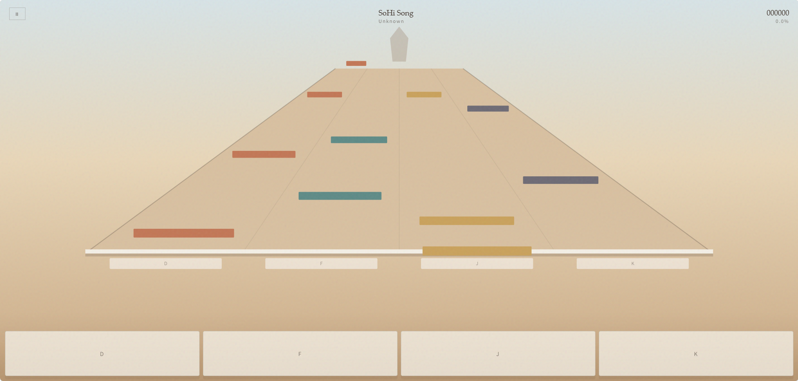

<div align="center">

# Monument Rhythm

**Packed via Axiox Media**

A four-lane static-page rhythm game. Song packs stay in the browser; the page never talks to a database.

<p>
  <a href="docs/README-zh.md"></a>
</p>

<p>
  <a href="#install">Install</a> ·
  <a href="#features">Features</a> ·
  <a href="#requirements">Requirements</a> ·
  <a href="#architecture">Architecture</a> ·
  <a href="#documentation">FAQ</a>
</p>

<p>
  
  
  
  
</p>

</div>

<div align="center">
  
</div>

> [!NOTE]
> This is a static site. Serve the whole folder over `http` or `https`. Opening `index.html` as `file://` still plays packs already stored in the browser; bundled demo fetch only works on a real origin.

---

## At a glance

| | |
|---|---|
| Product | Monument Rhythm / 沙碑节拍 |
| Kind | Static HTML page (no server runtime) |
| Play | Four lanes, `D` `F` `J` `K` or on-screen pads |
| Library | IndexedDB in the visitor’s browser |
| Packs | Zip of `audio` + `chart.json` per song folder |
| Skill | `SKILL.md` is built in the page and downloaded as a file |

<a id="install"></a>

## Install

### 1. GitHub Deploy Desk (recommended)

One-click deploy this repository with [GitHub Deploy Desk](https://github.com/axioxmedia/github-deployer).

1. Get the deployer: https://github.com/axioxmedia/github-deployer
2. Paste this repo URL into Deploy Desk.
3. Read the README in the app, then confirm deploy.

That is the supported install path. Use the static-host steps below only if you are already publishing from a local checkout.

### 2. Put the folder on a static host

Upload the project root so these paths stay siblings:

```
index.html
css/app.css
js/app.js
js/jszip.min.js
songs/…          optional bundled demos
packs/…          sample zips for the upload button
```

Then open `index.html` on that origin. A subdirectory such as `/cards/beat-game/` is fine; every asset uses a relative URL.

Local preview is the same folder opened through any static server. The page has no Python process and no API.

<a id="features"></a>

## Features

| Area | What it does |
|---|---|
| **Menu** | Lists packs saved in this browser |
| **Download SKILL.md** | Writes the chart-maker skill from text embedded in `index.html` (no extra HTTP file) |
| **Upload pack** | Accepts a zip from the skill; stores audio + chart in IndexedDB |
| **Local keep** | Same origin, same browser — the list returns after refresh |
| **Playfield** | Four receding lanes, Perfect / Great / Good / Miss |
| **Touch** | Four pads at the bottom, multi-touch |
| **Delete** | Removes one pack from this browser only |

<a id="requirements"></a>

## Requirements

| | Minimum | Comfortable |
|---|---|---|
| Browser | Current Chrome, Edge, Firefox, or Safari | Desktop or phone with audio |
| Storage | IndexedDB enabled | A few megabytes per song |
| Host | Any static file server | HTTPS recommended |
| Input | Keyboard or touch | `D` `F` `J` `K` |

Safari needs MP3 (or M4A) inside the pack. OGG will not play there.

<a id="architecture"></a>

## Architecture

```
browser
  ├── index.html          menu + playfield + embedded SKILL.md
  ├── css/app.css
  ├── js/app.js           timing, render, IndexedDB
  ├── js/jszip.min.js     zip import
  └── IndexedDB
        monument-rhythm / songs
            id, chart, audioBlob
```

The page does not list a server directory and does not keep a central song index. A pack exists only after the visitor uploads a zip, or after the optional bundled demos are copied into IndexedDB on first `http(s)` visit.

Skill output the page accepts:

```
<slug>/
  audio.mp3
  chart.json
```

One zip may hold several of those folders.

<a id="documentation"></a>

## Documentation

<details>
<summary>Why is the song list empty on a fresh machine?</summary>

IndexedDB is per origin and per browser. A new device, a private window, or another browser starts empty. Upload the zip again, or use the sample files under `packs/`.

</details>

<details>
<summary>Why did Download SKILL.md used to 403?</summary>

Some hosts block `.md`. The page no longer requests `skill/SKILL.md`. The button builds the file in the browser from the copy stored in `index.html`.

</details>

<details>
<summary>What does the skill zip have to contain?</summary>

Each song folder needs one browser-playable audio file and a `chart.json` with `notes`. Root-level `audio` + `chart.json` is also accepted. `__MACOSX` entries are ignored.

</details>

<details>
<summary>Keyboard and touch at once?</summary>

Yes. Lanes are `D` `F` `J` `K` from the left. Pads fire the same press path. `Esc` pauses.

</details>

Packed via Axiox Media · [axiox.media](https://axiox.media)
