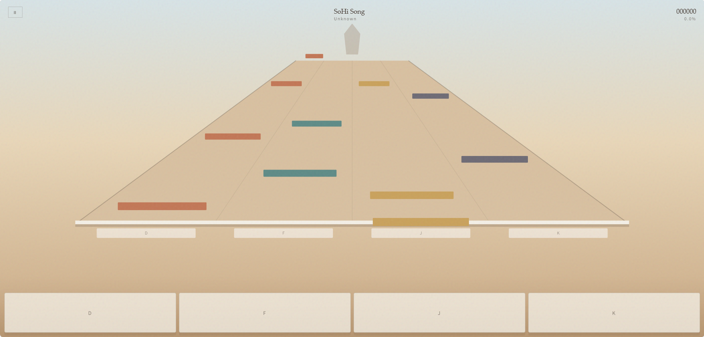

<div align="center">

# 沙碑节拍

**由安溯媒体打包**

四轨静态页游。曲包留在访客浏览器里，页面不接数据库。

<p>
  <a href="../README.md"></a>
</p>

<p>
  <a href="#install">安装</a> ·
  <a href="#features">功能</a> ·
  <a href="#requirements">环境</a> ·
  <a href="#architecture">结构</a> ·
  <a href="#documentation">问答</a>
</p>

<p>
  
  
  
  
</p>

</div>

<div align="center">
  
</div>

> [!NOTE]
> 这是静态站点。请用 `http` 或 `https` 打开整个文件夹。以 `file://` 打开时，已写入浏览器的曲包仍可玩；自带演示曲的首次拉取只在真实源上有效。

---

## 一览

| | |
|---|---|
| 产品 | 沙碑节拍 / Monument Rhythm |
| 形态 | 静态 HTML（无运行时后端） |
| 操作 | 四轨，`D` `F` `J` `K` 或屏上按键 |
| 曲库 | 访客浏览器的 IndexedDB |
| 曲包 | 每首歌一个文件夹：音频 + `chart.json`，再打成 zip |
| Skill | 正文写在 `index.html` 里，点击后生成 `SKILL.md` |

<a id="install"></a>

## 安装

### 1. GitHub Deploy Desk（推荐）

用 [GitHub Deploy Desk](https://github.com/axioxmedia/github-deployer) 一键部署本仓库。

1. 取得部署器：https://github.com/axioxmedia/github-deployer
2. 把本仓库地址贴进 Deploy Desk。
3. 在应用内阅读 README，确认部署。

这是支持的安装路径。只有在本地目录里自行发布时，才走下面的静态托管步骤。

### 2. 把文件夹放到静态空间

上传项目根目录，并保持这些路径同级：

```
index.html
css/app.css
js/app.js
js/jszip.min.js
songs/…          可选演示曲
packs/…          供「上传曲包」试用的 zip
```

在该源上打开 `index.html`。子目录（例如 `/cards/beat-game/`）可用，资源全部是相对路径。

本机预览同样是「整个文件夹 + 任意静态服务」。页面没有 Python 进程，也没有接口。

<a id="features"></a>

## 功能

| 区域 | 作用 |
|---|---|
| **主菜单** | 列出当前浏览器已保存的曲包 |
| **下载 SKILL.md** | 用写在 `index.html` 里的正文生成文件，不再请求额外的 `.md` |
| **上传曲包** | 接受 Skill 打好的 zip，把音频和谱面写入 IndexedDB |
| **本机保留** | 同一源、同一浏览器，刷新后列表仍在 |
| **游玩** | 四条透视轨道，Perfect / Great / Good / Miss |
| **触屏** | 底部四键，支持多指 |
| **删除** | 只从当前浏览器移除该曲 |

<a id="requirements"></a>

## 环境

| | 最低 | 舒适 |
|---|---|---|
| 浏览器 | 当前 Chrome、Edge、Firefox 或 Safari | 带扬声器的桌面或手机 |
| 存储 | 允许 IndexedDB | 每首歌数兆字节 |
| 托管 | 任意静态文件服务 | 建议 HTTPS |
| 输入 | 键盘或触屏 | `D` `F` `J` `K` |

Safari 需要曲包内为 MP3（或 M4A）。OGG 在该浏览器无法播放。

<a id="architecture"></a>

## 结构

```
浏览器
  ├── index.html          菜单、场地、内嵌 SKILL.md
  ├── css/app.css
  ├── js/app.js           判定、绘制、IndexedDB
  ├── js/jszip.min.js     解压曲包
  └── IndexedDB
        monument-rhythm / songs
            id, chart, audioBlob
```

页面不会枚举服务器目录，也没有总曲目表。曲包只在访客上传 zip 之后存在；若以 `http(s)` 首次打开且带有 `songs/`，演示曲会抄入 IndexedDB，之后同样走本机存储。

页面接受的 Skill 产物：

```
<slug>/
  audio.mp3
  chart.json
```

一个 zip 里可以有多个这样的文件夹。

<a id="documentation"></a>

## 问答

<details>
<summary>新设备上曲目是空的？</summary>

IndexedDB 按源、按浏览器隔离。新设备、无痕窗口或换浏览器都是空库。再次上传 zip，或使用 `packs/` 里的样例。

</details>

<details>
<summary>下载 SKILL.md 曾经 403？</summary>

部分主机拦截 `.md`。页面不再请求 `skill/SKILL.md`，按钮用写在 `index.html` 里的副本在浏览器中生成文件。

</details>

<details>
<summary>曲包 zip 里必须有什么？</summary>

每个歌曲文件夹需要一份浏览器可播的音频和带 `notes` 的 `chart.json`。压缩包根目录直接放音频 + `chart.json` 也可以。`__MACOSX` 项会被忽略。

</details>

<details>
<summary>键盘和触屏能同时用吗？</summary>

可以。从左到右是 `D` `F` `J` `K`。屏上按键走同一套按下逻辑。`Esc` 暂停。

</details>

由安溯媒体打包 · [axiox.media](https://axiox.media)
